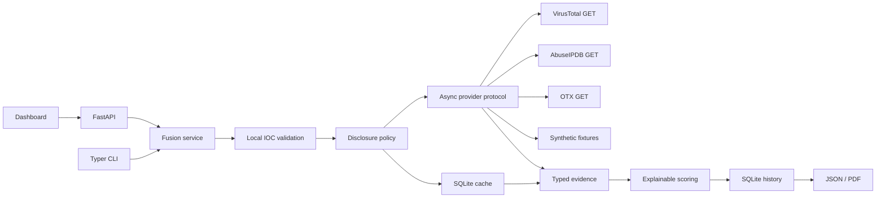

# Architecture and extension guide

The UI never needs provider keys. It talks only to the same-origin backend. The service validates input, evaluates disclosure policy, checks provider-specific cache, concurrently gathers normalized results, scores available evidence, and stores an immutable analysis snapshot. The API uses a lifespan-scoped HTTP client; CLI commands create/close their client explicitly. SQLite work and PDF generation are moved off the API event loop.

## Add a provider

Implement `Provider` from `providers.py`: unique `name`, `supported: set[IOCType]`, and `async enrich(ioc) -> ProviderResult`. Inject your list with `Fusion(settings, client, providers=[...])`, or extend `live_providers`. The orchestrator checks privacy before calling plugins. Plugins are trusted code and must obey the same GET-only, no-execution policy. Return typed `Evidence` with source identity, metric, source URL, UTC retrieval date, and observation date when available. New signal types require adding a model literal and explicitly documented scoring rule; never silently interpret unrelated provider numbers as equivalent.

Each provider runs independently; failure becomes a status result. Cancellation is allowed to propagate. Only normalized numeric fields and predefined descriptions are retained. HTTP status/error messages deliberately omit raw response bodies and exception strings. Unexpected plugin exceptions are sanitized. Provider normalization should fail closed on missing or inconsistent numeric data.

## Design choices and limits

- Pure validation and scoring functions are independently testable.
- Domain IDNA normalization and IPv6 compression avoid duplicate cache identities. URL fragments are removed; default ports are preserved because provider URL identifiers may distinguish them.
- A result cache preserves source observations and retrieval dates; each invocation gets a new analysis UUID.
- TTL covers successful lookups and absent records, not failures or permissions.
- Unknown observations reduce freshness instead of substituting current time.
- No DNS resolution or indicator fetching means the app is not a scanner and cannot prove hostname routability.
- Correlated provider/engine signals prevent probabilistic interpretation of scores.
- Reports escape markup and do not create suspicious hyperlinks. Dashboard data is inserted through `textContent`, with a restrictive content security policy.
- Single-user scope: no enterprise RBAC, distributed limiter, encrypted database, multi-process quota coordination, or validated classifier is claimed.

## Milestones implemented

1. Local IOC validation and schemas, with positive/negative/security fixtures.
2. Provider protocol and three async normalized adapters, bounded retries, attribution.
3. Transparent heuristic scoring and independent evidence-quality metrics.
4. SQLite persistence and cache, explicit privacy policy, key-free demo.
5. FastAPI, CLI, web workbench, JSON and PDF export.
6. Mocked integration coverage, CI, installation and security documentation.

Future work should prioritize evaluation against labeled datasets, calibrated uncertainty, domain-resolution policy with explicit consent, tenant isolation, and deployment threat modeling before automated response decisions.

## Investigation layer (1.1)

`extraction.py` converts bounded local text into `Case` objects with source references and relationships. `triage.py` supplies explainable workflow priorities independently of provider risk. `cases.py` owns background enrichment jobs and privacy-filtered selections. SQLite case mutations use BEGIN IMMEDIATE to avoid lost findings during enrichment. Jobs persist progress, retain partial results on cancellation, and are marked interrupted after restart without automatic external retries. `case_reports.py` exports source-linked findings as JSON/CSV/PDF. The case workbench is `/`; the original lookup UI is `/lookup`.

Tags and edges are intentionally narrow: same-line association is not proof of a network connection, and a local keyword is not proof of maliciousness. Source excerpts and analyst notes are sensitive local data. The existing optional API key applies to all case and job endpoints.
