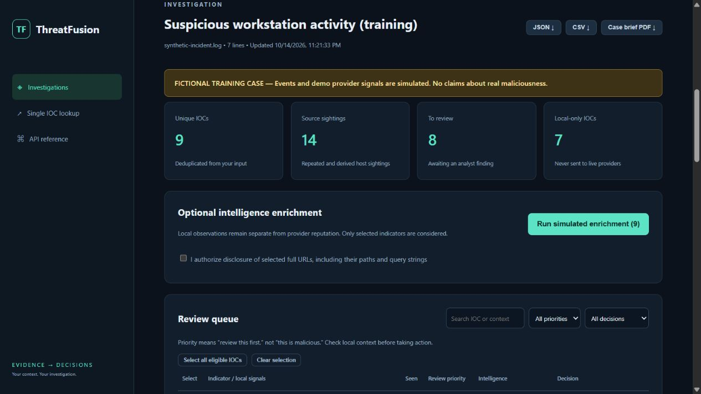
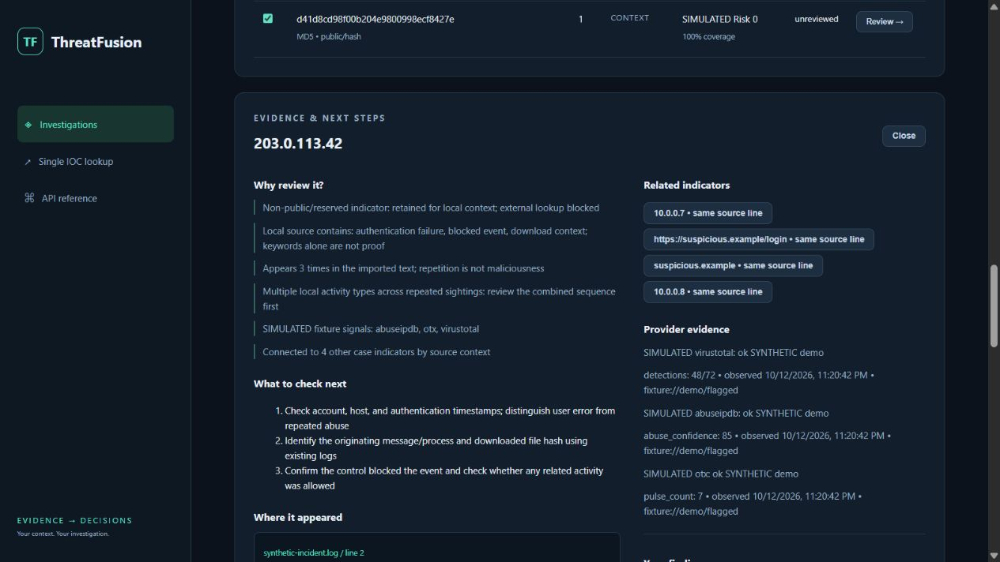

# ThreatFusion

**Turn noisy local evidence into a traceable investigation.**

ThreatFusion is a local investigation workbench. Import logs, email text, CSV/JSON text, or IOC lists; extract and deduplicate indicators; inspect their source lines and connections; prioritize a review queue; record findings; and export a case brief. External reputation lookup is an optional step in that workflow. The app does not need provider keys to organize and investigate your own evidence.

> Scores are unvalidated heuristics, not calibrated probabilities or a malicious/benign verdict. Demo evidence is entirely synthetic. Missing records and low scores do not establish safety.





## Why use it?

An isolated reputation lookup answers what a provider knows about one IOC. ThreatFusion adds your local context: **where did this indicator appear, how often, alongside what activity, which related indicators need review, and what did the analyst conclude?**

For example, import a firewall/endpoint excerpt containing a repeated IP, a defanged download URL, an internal host, and a file hash. The workbench links the source events, puts repeated multi-context activity near the top of a review queue, preserves the private host locally, suggests concrete checks, and saves your finding with the evidence. You can then enrich only the public indicators you choose and export the complete investigation.

## Investigation walkthrough

1. Run `threatfusion serve` and open http://127.0.0.1:8000.
2. Click **Try a fictional incident walkthrough** to learn without external calls, or import your own supported text file/paste evidence.
3. Review the queue and open an IOC. Inspect original line excerpts, local activity tags, connected indicators, and suggested next checks.
4. Optional: select IOCs for enrichment. A fictional case runs synthetic providers only. A real case requires live configuration; private/reserved IOCs stay local and full URLs remain blocked unless you explicitly consent.
5. Record an evidence-backed note and choose **Investigate**, **Expected activity**, or **Escalate**. These are analyst decisions, separate from provider numbers.
6. Export JSON, CSV, or a PDF case brief including source references, rationale, provider gaps, findings, and activity history.

The original single-IOC tool remains at `/lookup`. The main page is now the case workbench.

### Local import and privacy

- Import is offline: no DNS resolution, target visits, external submissions, or sample execution.
- Input is bounded to 200,000 characters, 10,000 lines, and the first 200 unique IOCs. Excess indicators are reported, not silently claimed as processed.
- `hxxp(s)://`, `[.]`, and `(.)` are refanged only for local parsing. Original source excerpts are retained.
- Extraction is heuristic. It recognizes supported syntactic IOC types and skips common executable/log filename suffixes, but can still miss or misclassify domain-like text. Review the source.
- Each IOC keeps a total sighting count and up to 12 source-line excerpts. Excerpts are limited to 500 characters; retain your original input. Full raw input is not retained, but its SHA256 is saved for integrity reference.
- Connections mean same-line co-occurrence or URL-host containment, not confirmed network communication or attribution. A URL's derived hostname is shown as a separate indicator.
- Local tags flag words associated with authentication failure, blocked events, downloads, and execution. Repeated sightings across multiple tag types get high **review priority**; these hints do not assert maliciousness or replace provider risk scores.
- Background enrichment processes deduplicated selections, preserves partial results, supports cancellation, and never auto-resumes on restart. Already-sent requests cannot be recalled. At most four jobs are admitted and two run concurrently per app process; durable multi-worker quota coordination remains future work.
- Source excerpts and notes can contain sensitive information. They stay in local SQLite and exported reports. Protect these files. Deleting a case removes its case/job records; separate IOC analysis history/cache must be cleared separately.
- CSV export neutralizes leading spreadsheet formula characters. PDFs escape markup and do not make suspicious IOCs clickable.

### Case CLI

```bash
threatfusion case-import events.log --title "Workstation investigation"
threatfusion case-list
threatfusion case-report CASE_ID case-brief.pdf
threatfusion case-report CASE_ID indicators.csv
```

CLI import makes no provider calls. Use the dashboard for background enrichment and analyst findings.

### Case API

| Method | Endpoint | Purpose |
| --- | --- | --- |
| POST | `/api/cases` | Import `{title, source_name, text}` locally |
| POST | `/api/cases/demo` | Create a fictional training case |
| GET | `/api/cases?limit=20&offset=0` | List saved case summaries |
| GET | `/api/cases/{id}` | Full source-linked investigation |
| PATCH | `/api/cases/{id}/indicators/{indicator_id}` | Save `{disposition, note}` |
| POST | `/api/cases/{id}/enrich` | Start `{mode, selected, allow_url}` job; 202 |
| GET | `/api/jobs/{id}` | Progress and partial-completion counts |
| POST | `/api/jobs/{id}/cancel` | Stop queued/remaining work |
| GET | `/api/cases/{id}/report?format=json|csv|pdf` | Export a case brief |
| DELETE | `/api/cases/{id}` | Delete case and job records after cancelling active work |

The existing optional API key protects these routes. Case updates use atomic SQLite transactions so enrichment cannot overwrite a saved finding. Request-body limits are enforced while streaming, including chunked requests.

## Quick start

Python **3.11+**. Extract this repository, open a terminal inside it, and run:

```bash
python -m venv .venv
# Windows PowerShell:
.venv\Scripts\Activate.ps1
# macOS/Linux instead:
# source .venv/bin/activate
python -m pip install -e ".[dev]"
```

Copy `.env.example` to `.env` (`Copy-Item .env.example .env` in PowerShell, `cp .env.example .env` on macOS/Linux). Demo mode is the default even without this file.

```bash
threatfusion demo
threatfusion analyze 203.0.113.42
threatfusion analyze suspicious.example --output reports/demo.pdf
threatfusion analyze 203.0.113.42 --json --output reports/demo.json
threatfusion serve
```

Open **http://127.0.0.1:8000** for the dashboard and **http://127.0.0.1:8000/docs** for interactive API documentation. Choose a fixture chip, click Analyze, inspect source evidence, then export a report. Stop with Ctrl+C.

On Windows, activation can be skipped by using `.venv\Scripts\threatfusion.exe` directly; no execution-policy change is necessary.

### Key-free demo

**The demo score for `203.0.113.42` is fictional.** It is not its VirusTotal reputation. This address belongs to the documentation-only TEST-NET-3 range; live mode blocks it. A real VirusTotal result of 0 detections means no vendors flagged that record, not guaranteed safety. The dashboard, CLI, and reports label simulated evidence explicitly.

All seven IOC types have packaged fixtures. They use documentation IP ranges, `.example` domains, and empty-file hashes. These names and hashes **do not carry real reputation claims**. Flagged, quiet, and stale profiles demonstrate scoring and missing freshness. An IOC without a fixture returns `not_found` and unknown risk. Demo ignores API keys and never constructs real providers.

## Live enrichment

Edit `.env` with `THREATFUSION_DEMO=false` and the API keys you own:

| Variable | Provider |
| --- | --- |
| `THREATFUSION_VT_KEY` | VirusTotal |
| `THREATFUSION_ABUSE_KEY` | AbuseIPDB |
| `THREATFUSION_OTX_KEY` | AlienVault OTX |

Missing keys produce `unconfigured`; other sources still run. A CLI invocation can explicitly select live mode with `--live`.

```bash
threatfusion analyze 8.8.8.8 --live
threatfusion analyze https://example.com/path --live --allow-url
threatfusion validate 2001:4860:4860::8888
threatfusion history --limit 20
threatfusion clear-history --yes
```

**Disclosure policy:** live IP lookups are restricted to globally routable, non-multicast addresses. Reserved/local domain suffixes are blocked. Full URL lookups require `--allow-url` / `allow_url: true` / the dashboard checkbox for each request, including cache hits. Non-public URL hosts remain blocked even with consent. No URL is visited, resolved, rescanned, or submitted for analysis, and no file is uploaded or executed. Only GET requests to fixed provider origins are supported. An existing URL lookup still discloses the full URL, including query secrets; remove sensitive values before opting in. Public domains may also be sensitive to your organization; choose demo mode for confidential indicators.

Syntax validation does not claim that a domain exists. It does not resolve DNS, so public-looking domain names that resolve privately cannot be classified here. Defanged indicators and single-label hostnames are rejected; refang manually only after reviewing the data.

## REST API

| Method | Endpoint | Purpose |
| --- | --- | --- |
| GET | `/api/health` | Status, version, mode (public) |
| GET | `/api/demo` | Fixture values |
| POST | `/api/analyze` | Validate, enrich, score, persist |
| GET | `/api/history?limit=20&offset=0` | Paginated recent reports |
| DELETE | `/api/history` | Clear history/cache |
| GET | `/api/analyses/{id}` | Retrieve saved analysis |
| GET | `/api/analyses/{id}/report?format=json` | Download JSON |
| GET | `/api/analyses/{id}/report?format=pdf` | Download PDF |

Example request:

```json
{"value":"203.0.113.42","allow_url":false,"refresh":false}
```

`refresh` bypasses successful-result cache entries but respects provider cooldowns. Responses include normalized IOC, mode, UUID, UTC analysis timestamp, per-provider status/attempts/cache state, typed evidence, source references, retrieval/observation dates, and score explanation. Errors: invalid IOC or request 422; missing analysis 404; invalid API key 401. Provider failures return an analysis with explicit per-source failure states, rather than hiding partial results.

Set `THREATFUSION_API_KEY` to protect API data and operations using the `X-API-Key` header. Enter it in the dashboard's authentication panel; it stays in page memory. The CLI refuses to bind beyond loopback without a key. For deployment use `uvicorn threatfusion.api:create_app --factory --host 127.0.0.1` behind an authenticated TLS reverse proxy. Do not expose the raw development server. The API is a single-user workbench, with no user accounts or tenant isolation; a configured key also grants deletion rights. Health and dashboard assets are public. Interactive docs describe the API; supply the header in your API client for protected routes.

## Explainable scoring

| Signal | Contribution |
| --- | --- |
| VirusTotal malicious engines / all returned analysis categories | Ratio × 60, capped at 60 |
| AbuseIPDB abuseConfidenceScore | Score × 0.30, capped at 30 |
| OTX community pulse associations | Count × 2, capped at 10 |

Risk is the rounded sum, capped at 100. Missing sources never redistribute weight. No usable evidence yields `risk: null`, label `unknown`. Labels: below 30 `low signal`, 30–59 `elevated`, 60+ `high`. An IP fixture with 48/72 malicious engines, abuse score 85, and 7 pulses yields **76**.

- **Coverage:** usable sources / sources that support the IOC type. Missing keys, blocked requests, absent records, and errors reduce it; unsupported providers are excluded.
- **Freshness:** average `max(0, 1 - observation_age_days / 90)` across evidence, expressed as percent. Missing observation dates contribute zero. Cached retrieval timestamps never refresh source observations. Future dates are treated as age zero.
- **Confidence:** rounded `coverage × (0.4 + 0.6 × freshness/100) × min(1, usable_sources/2)`. This is an explicit completeness proxy, not empirical confidence in a verdict.

Sources can repeat each other's intelligence. Engine agreement is correlated, pulse association is not proof, and older intelligence can still matter. No benchmark, calibration, or false-positive-rate validation has been performed. Risk intentionally stays separate from freshness and availability so stale signals remain visible. See [ARCHITECTURE.md](ARCHITECTURE.md) for design and extension details.

## Reliability and storage

Async requests run concurrently across sources, with per-provider serialization, 8 concurrent enrichment slots, HTTP timeouts, bounded retry/backoff, and a 120-second provider deadline. 429 responses support seconds and HTTP-date `Retry-After`. Waits above the configured cap return `rate_limited` immediately and activate a cooldown; no long quota waits or automatic submissions. 401/403/404 are not retried. Transport failures and 5xx are retried within configured bounds; malformed payloads are isolated. Redirects are disabled and environment proxies are ignored.

SQLite uses parameterized queries, WAL, short connections, and worker threads. Only `ok` and `not_found` results are cached; policy checks happen first. Demo/live caches are separated and the cache key includes schema version, source, IOC type, and normalized value. Retrieval timestamps are preserved on hits. Default TTL is one hour; history keeps each analysis until cleared. Run one app process to share cooldowns; multiple processes have separate quota state and can duplicate requests. Concurrent identical cache misses may also duplicate lookups. SQLite files are **not encrypted**, and reports/history contain sensitive indicators. Protect the data directory, use disk encryption, and choose your own retention schedule. Clearing data is not guaranteed secure erasure from SSDs or backups.

## Tests and quality checks

```bash
pytest --cov=threatfusion --cov-report=term-missing --cov-fail-under=85
ruff check .
ruff format --check .
```

Tests use HTTPX MockTransport and FastAPI TestClient; they require no API keys and no live network. They cover validation, all provider adapters, routes, retries/429/auth failures, privacy blocks before cache, storage, concurrency, scoring, CLI workflows, and report text. CI runs these on Linux/Windows with Python 3.11–3.13. Live compatibility still depends on your provider entitlement, quota, and future API changes. See [VERIFICATION.md](VERIFICATION.md) for the actual local verification results.

## Provider references

Adapters are based on official provider documentation and SDK routes:

- [VirusTotal existing URL report](https://docs.virustotal.com/reference/url-info), [IP object](https://docs.virustotal.com/reference/ip-object)
- [AbuseIPDB v2 check endpoint](https://docs.abuseipdb.com/#check-endpoint)
- [AlienVault OTX Python SDK](https://github.com/AlienVault-OTX/OTX-Python-SDK/blob/master/OTXv2.py)

Respect each provider's terms, data handling rules, and quotas. Raw provider responses and API credentials are never stored in reports. Provider references are displayed as text, not navigable IOC links.

## Repository

```text
src/threatfusion/
  validation.py     IOC syntax and disclosure classification
  models.py         Typed normalized evidence/report schemas
  providers.py      Protocol and async live adapters
  demo.py           Network-free synthetic providers
  scoring.py        Explicit heuristic contributions and quality metrics
  storage.py        SQLite cache/history
  service.py        Policy, orchestration, partial-failure isolation
  api.py            FastAPI routes and dashboard host
  cli.py            Typer/Rich commands
  reports.py        Escaped JSON/PDF export support
  static/           Responsive dashboard, no external assets
  fixtures/         Packaged demo data
tests/              Unit and mocked integration tests
.github/workflows/  CI
```

MIT licensed. Built for defensive learning and portfolio demonstration.

## Remaining work

The local investigation workflow is implemented. Wider live-provider verification, empirical score evaluation, production deployment hardening, and automated browser regression tests remain open. See [ROADMAP.md](ROADMAP.md) for priorities and acceptance criteria.
